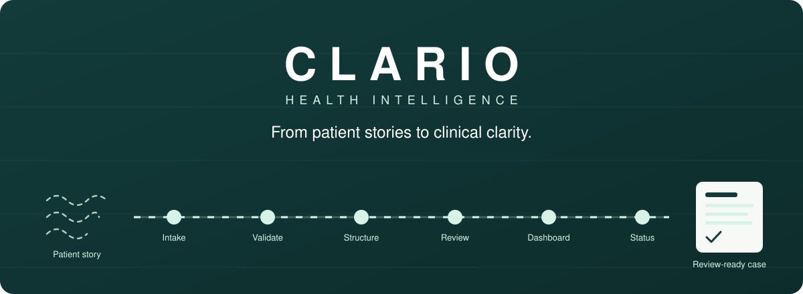
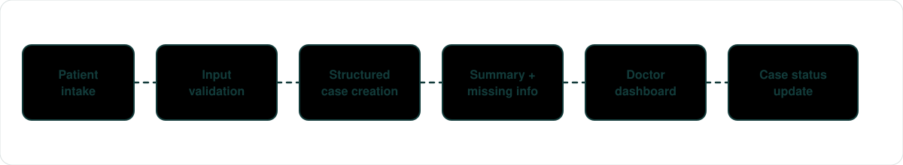
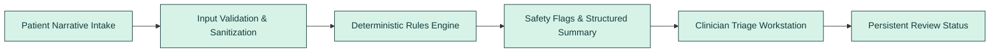
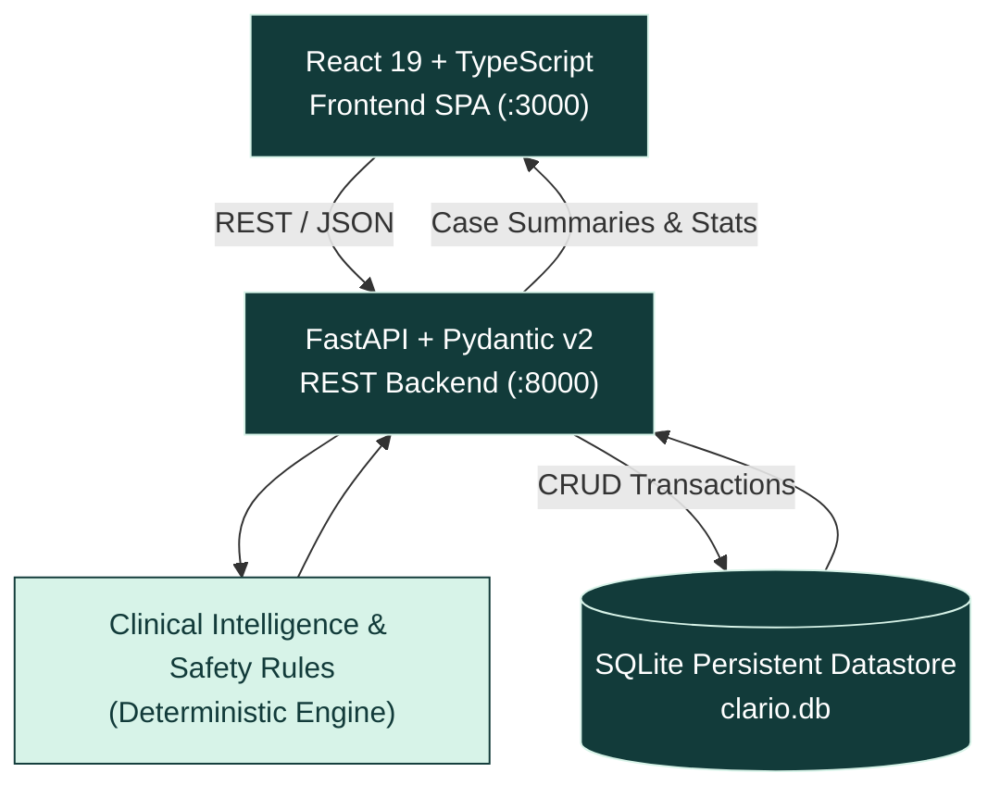

<div align="center">



<br>

**From patient stories to clinical clarity: AI-assisted case-taking that transforms patient-reported symptoms into structured clinical summaries, identifies missing information, and streamlines doctor review through a connected digital workflow.**

<br>

[](https://react.dev/)
[](https://www.typescriptlang.org/)
[](https://fastapi.tiangolo.com/)
[](https://docs.pydantic.dev/)
[](https://www.sqlite.org/)
[](docs/TESTING_AND_VERIFICATION.md)
[](LICENSE)

[Overview](#overview) · [Workflow](#from-patient-narrative-to-review-ready-case) · [Architecture](#system-architecture) · [Features & Status](#features-and-status) · [Documentation](#-complete-documentation-suite) · [API](#api-endpoints) · [Quickstart](#quick-start) · [Testing](#automated-verification--testing) · [Safety Disclaimers](#safety-and-limitations)

</div>


## Overview

In acute and ambulatory healthcare, patient-reported symptoms often arrive as scattered, emotionally charged narratives with vital diagnostic information omitted. Clinicians waste critical consultation minutes piecing together basic facts or chasing missing parameters such as pain scores or medication dosages.

**CLARIO** is an AI-assisted patient case-taking and clinical documentation prototype designed for healthcare teams. It guides patients through a structured digital intake process, sanitizes and organizes their responses into an objective case draft without fabricating clinical facts, detects emergency safety flags (cardiac, stroke, severe respiratory distress), parses medications and physiological vitals, and presents cases to clinicians in a real-time triage workstation.

### Key Capabilities
- **Connected Digital Workflow:** Direct bridge from patient intake to clinician triage dashboard.
- **Deterministic & Explainable:** 100% rule-based safety flags and physiological checks. Zero cloud LLM hallucinations, zero token-limit failures, and zero external network latency.
- **Structured Clinical Drafting:** Generates an objective, EHR-ready clinical summary separated clearly from raw patient narrative.
- **Proactive Missing-Information Prompts:** Flags omitted pain ratings (1-10), unverified allergy status, and unquantified medication strengths.
- **Persistent State Management:** Real-time triage queue with review state tracking (`pending` → `in_review` → `completed`) persisted directly in SQLite.


## From Patient Narrative to Review-Ready Case






## System Architecture



| Layer | Technology | Primary Responsibilities |
|---|---|---|
| **Frontend** | React 19, TypeScript 5.8, Vite 6 | Patient intake portal, clinician triage workstation, case modal, responsive CSS design system (`#123B3A` Deep Teal, `#D7F3E8` Mint). |
| **Backend API** | FastAPI, Uvicorn, Pydantic v2 | Request validation, error handling, CORS headers, REST routing. |
| **Clinical Intelligence** | Deterministic Python Engine | Text sanitization (`text_cleaner.py`), emergency red flags, medication & vitals parsing, missing-information engine (`clinical_rules.py`). |
| **Storage Layer** | SQLite 3 (`clario.db`) | ACID-compliant persistent local storage with indexed queries and zero-config deployment. |


## Features and Status

Legend: ✅ Verified & Tested · 🛠 In Progress · 🗺 Future Roadmap

| Feature | Description | Status |
|---|---|:---:|
| **Structured Patient Intake Form** | Multi-section validated form capturing demographics, complaints, symptoms, history, and medications. | ✅ Verified |
| **Quick-Fill Demo Presets** | One-click clinical demo presets (Cardiac Red Flag, Cough & Fever, Infant High Fever). | ✅ Verified |
| **Input Sanitization & Normalization** | Strips non-printable ASCII noise, line-ending variances, and collapses whitespace while preserving clinical negations. | ✅ Verified |
| **Cardiac / ACS Red Flag Detection** | Deterministic screening for chest pressure radiating to arm/jaw, diaphoresis, and acute coronary symptoms. | ✅ Verified |
| **Stroke Warning Flags (FAST Criteria)** | Immediate detection of facial droop, slurred speech, arm weakness, and thunderclap headache. | ✅ Verified |
| **Severe Respiratory Distress Detection** | Alerts on cyanosis, stridor, severe dyspnea, and SpO2 < 92%. | ✅ Verified |
| **Deterministic Medication & Dosage Parser** | Structures drug names, forms (`tab`, `cap`, `syp`), dosages (`mg`, `mcg`), and frequencies (`OD`, `BD`, `PRN`). | ✅ Verified |
| **Polypharmacy Risk Alert** | Proactively flags patients taking ≥ 5 concurrent medications for clinician reconciliation. | ✅ Verified |
| **Physiological Vitals & Lab Range Alerts** | Extracts BP, SpO2, HR, Temp, Blood Glucose, and Hemoglobin with clinical range alerts. | ✅ Verified |
| **Missing-Information Detection** | Prompts clinicians when pain numerical scale (1-10) is omitted, allergies unconfirmed, or onset vague. | ✅ Verified |
| **Clinician Triage Workstation** | Real-time queue with dynamic stats (Total, Pending, In Review, Completed, Critical Flags). | ✅ Verified |
| **Queue Search & Tabbed Filtering** | Instant search by case ID, patient name, and complaint, with status tabs (`all`, `pending`, `in_review`, `completed`, `critical`). | ✅ Verified |
| **Interactive Case Review Modal** | Split-view layout displaying patient narrative, clinical draft, red flags, vitals, and physician notes scratchpad. | ✅ Verified |
| **Persistent Workflow State Management** | Case transitions (`pending` → `in_review` → `completed`) persist in SQLite across reloads and restarts. | ✅ Verified |
| **Automated Integration Test Suite** | 13/13 passing automated integration and clinical rule tests (`backend/test_api.py`). | ✅ Verified |
| **FHIR / HL7 Export Integration** | Export cases to standardized HL7 FHIR clinical document format. | 🗺 Roadmap |
| **Multilingual Patient Intake** | Multi-language patient interface with standardized English clinical translation. | 🗺 Roadmap |


## 📖 Complete Documentation Suite

All detailed system, clinical, and architectural specifications are located in the [`docs/`](docs/) directory:

- 📄 [**Software Requirements Specification (SRS)**](docs/REQUIREMENTS.md): Complete functional and non-functional requirements, data boundaries, and acceptance criteria.
- 📋 [**Product Requirements Document (PRD)**](docs/PRD.md): Product vision, clinical pain points, user personas, MoSCoW prioritization, and success metrics.
- 🏗️ [**System Architecture & Technical Design**](docs/ARCHITECTURE.md): Deep-dive into technical architecture, Mermaid diagrams, SQLite schema, and security controls.
- 🩺 [**Clinical Rules & Safety Engine Specification**](docs/CLINICAL_RULES.md): Exhaustive clinical documentation of red flag triggers, vitals ranges, medication parser, and missing info prompts.
- 🔌 [**REST API Specification & Reference**](docs/API_DOCUMENTATION.md): Endpoint contracts, Pydantic schemas, request/response examples, and error status codes.
- 👤 [**User Guide & Operational Manual**](docs/USER_GUIDE.md): Operational guide for patients and clinicians, including step-by-step walkthroughs and preset instructions.
- 🧪 [**Testing & Quality Assurance Report**](docs/TESTING_AND_VERIFICATION.md): Test execution results, test cases, and verification methodology.
- 🔍 [**Reference Audit & Feature Integration Plan**](docs/REFERENCE_AUDIT.md): Comparative technical audit between MEDI-KIOSK1 reference pipeline and CLARIO.
- 📑 [**Documentation Index**](docs/README.md): Hub connecting all documents for clinicians, engineers, and QA auditors.

*(Note: The [`doc/`](doc/) folder also mirrors the complete documentation suite for standard navigation).*


## API Endpoints

Base URL (local): `http://localhost:8000`. Interactive documentation is available at `http://localhost:8000/docs`.

| Method | Endpoint | Description |
|---|---|---|
| `GET` | `/health` | Health check verifying FastAPI and SQLite database connectivity |
| `GET` | `/api/stats` | Triage workstation overview counts (total, pending, in_review, completed, critical) |
| `GET` | `/api/cases` | List cases with optional `status` filter and `search` query |
| `POST` | `/api/cases` | Submit a new patient intake; executes sanitization and clinical rules |
| `GET` | `/api/cases/{id}` | Retrieve complete clinical record and generated draft for a single case |
| `PATCH` | `/api/cases/{id}/status` | Update case review status (`pending`, `in_review`, `completed`) and doctor notes |


## Quick Start

### Prerequisites
- **Python:** 3.10 or higher
- **Node.js:** v18 or higher (with npm)
- **Git**

### 1. Clone Repository
```bash
git clone https://github.com/Nishith45o7/CLARIO--health-intelligence-.git
cd CLARIO--health-intelligence-
```

### 2. Start Backend API (Terminal 1)
```powershell
# In PowerShell / Command Prompt:
cd backend
python -m pip install -r requirements.txt
python -m uvicorn main:app --host 0.0.0.0 --port 8000 --reload
```
- API Health Check: `http://localhost:8000/health`
- Interactive Swagger Docs: `http://localhost:8000/docs`

### 3. Start Frontend Workstation (Terminal 2)
```powershell
# In PowerShell / Command Prompt:
cd frontend
npm install
npm run dev
```
- Open your browser to `http://localhost:3000` (or `http://localhost:5173`).
- Navigate between **Patient Intake** (`/`) and **Doctor Dashboard** (`/dashboard`).


## Automated Verification & Testing

CLARIO includes a comprehensive automated integration test suite that runs against the live API and clinical rules:

```powershell
python "backend/test_api.py"
```

### Verification Output:
```text
--- Starting CLARIO Backend Integration Tests ---
[PASS] GET /health: healthy - SQLite (persistent)
[PASS] GET /api/stats: 10 total, 3 pending, 7 critical
[PASS] GET /api/cases: retrieved 10 cases
[PASS] POST /api/cases: Created CLR-91596 with emergency flag=True (Potential Acute Coronary / Cardiac Warning)
[PASS] GET /api/cases/CLR-91596: Exact match confirmed
[PASS] PATCH /api/cases/CLR-91596/status: Transitioned to 'in_review'
[PASS] PATCH /api/cases/CLR-91596/status: Transitioned to 'completed'
[PASS] Invalid case ID rejected with HTTP 404
[PASS] Invalid status rejected with HTTP 422
[PASS] Medication extraction verified: 3 medications structured
[PASS] Clinical text cleaner removed noise lines and excessive spacing
[PASS] Vitals extraction & physiological range alerts verified: ['Blood Pressure', 'Oxygen Saturation (SpO2)', 'Heart Rate / Pulse', 'Body Temperature']
[PASS] Medication parser form, dosage, and frequency patterns verified

>>> ALL 13 INTEGRATION & CLINICAL CHECKS PASSED WITH 100% SUCCESS! <<<
```

To build and verify the frontend bundle:
```powershell
cd frontend
npm run build
```


## Design System

CLARIO features a tailored, healthcare-grade visual design system built with WCAG AA compliant contrast ratios:
- **Deep Teal (`#123B3A`):** Core brand, navigation bars, primary action buttons (Contrast ratio > 11:1).
- **Mint (`#D7F3E8`):** Active status badges, accent elements, secondary indicators.
- **Canvas (`#F7F9F7`):** Clean, eye-fatigue reducing soft background surface.
- **Surface Cards (`#FFFFFF`):** High-contrast, scannable clinical card containers.
- **Emergency Crimson (`#DC2626` / `#FEE2E2`):** Transparent red-flag warning cards with high-visibility callouts.


## Safety and Limitations

> **IMPORTANT CLINICAL NOTICE**
> 
> - **Clinical Documentation Prototype:** CLARIO is a prototype intended exclusively for clinical workflow enhancement and documentation drafting.
> - **Non-Diagnostic:** CLARIO does not diagnose medical conditions, provide autonomous triage, or prescribe pharmaceutical treatments.
> - **Physician Oversight:** All structured summaries, red-flag banners, and missing-information prompts are preliminary drafts subject to independent verification by qualified licensed healthcare professionals.
> - **Synthetic Demonstrations:** All patient records included in the repository and demo presets are strictly synthetic fixtures.


## Contributing & License

Contributions, feedback, and clinical evaluations are welcome. Please ensure that all pull requests include automated test coverage and utilize synthetic data only.

This project is licensed under the terms of the [MIT License](LICENSE).

<div align="center">

<br>

**CLARIO: From patient stories to clinical clarity.**

</div>
