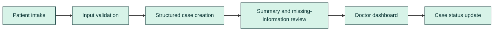
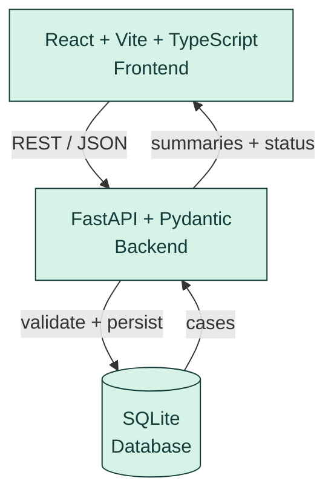

<!--
  BEFORE PUBLISHING: this README was drafted from the project brief, not from a code audit.
  Confirm every path, command, endpoint and status marked "Implemented, unverified",
  then update the Status column after you actually run the app and tests.
-->

<div align="center">


<br>

**A patient case-taking and clinical documentation workflow that turns patient-reported information into structured case summaries for clinician review.**

<br>


[Overview](#overview) · [Problem](#the-problem) · [Solution](#from-patient-narrative-to-review-ready-case) · [In Action](#see-clario-in-action) · [Architecture](#architecture) · [Status](#features-and-status) · [API](#api) · [Quickstart](#quickstart) · [Testing](#testing-and-verification) · [Safety](#safety-and-limitations) · [Roadmap](#roadmap)

</div>


## Overview

| | |
|---|---|
| **Category** | Healthcare workflow and documentation prototype |
| **Intended users** | Patients (intake) and clinicians (case review) |
| **Frontend** | React + Vite + TypeScript |
| **Backend** | FastAPI + Pydantic |
| **Data storage** | SQLite |
| **Summary approach** | Deterministic, rule-based structuring of patient-reported fields *(not LLM-generated)* |
| **Status** | Functional MVP prototype. See [Features and Status](#features-and-status) |

**Quick answers**

- **Problem:** Unstructured, incomplete intake information makes case review slower and more error-prone.
- **Who has it:** Clinicians reviewing patient-reported information, and patients asked to repeat missing details.
- **Solution:** One connected workflow: intake → validation → structured case → missing-information prompts → clinician dashboard → status tracking.
- **What works today:** See the [status matrix](#features-and-status).
- **How to run it:** See the [Quickstart](#quickstart). No API keys are required for the core workflow.


## The Problem

Patient-reported symptoms often arrive as free text, spread across fields and notes, with key details missing. At a workflow level this means:

- Important context is scattered and harder to scan.
- Missing information triggers follow-up that could have been prompted at intake.
- Clinicians need a clear, consistent view of what the patient actually reported.
- Disconnected intake and review steps add avoidable friction.

CLARIO connects patient intake, structured summaries, missing-information prompts and clinician review into a single workflow.

> CLARIO does not diagnose, does not replace clinicians, and has not demonstrated any improvement in clinical outcomes.


## From Patient Narrative to Review-Ready Case




What is technically meaningful here (to the extent the implementation supports it):

- **Connected patient-to-clinician path** rather than isolated demo screens.
- **Structured storage** of each case in a database.
- **Transparent presentation** of patient-reported facts, kept separate from any interpretation.
- **Explicit missing-information prompts** so gaps are visible, not silent.
- **Persistent case status** for tracking review progress.
- **Clear boundary** between documentation assistance and clinical decision-making.


## See CLARIO in Action

> Screenshots must be captured from the running app using **synthetic data only**. Save them in `docs/assets/` and uncomment the images below.

| # | Screen | File | Captured |
|---|---|---|---|
| 1 | Patient intake form | `docs/assets/clario-patient-intake.png` | ☐ |
| 2 | Submission success and generated summary | `docs/assets/clario-summary.png` | ☐ |
| 3 | Doctor dashboard and case queue | `docs/assets/clario-doctor-dashboard.png` | ☐ |
| 4 | Case detail view | `docs/assets/clario-case-details.png` | ☐ |
| 5 | Status update, persisted after refresh | `docs/assets/clario-status-update.png` | ☐ |

<!--
<p align="center">
  
  
</p>
<p align="center">
  
</p>
-->


## Architecture



| Layer | Responsibility |
|---|---|
| **Frontend** | Patient intake form, doctor dashboard, case detail view, status controls |
| **Backend** | Request validation (Pydantic), summary generation, missing-information detection, persistence |
| **Database** | Stores submitted cases and their status across restarts |

**Summary generation:** rule-based and deterministic. No LLM is used in the core workflow.


## Features and Status

Legend: ✅ Verified · 🟡 Implemented, unverified · 🛠 In progress · 🗺 Planned

| Feature | Status |
|---|---|
| Patient intake form | 🟡 |
| Input validation | 🟡 |
| Persistent case storage (SQLite) | 🟡 |
| Structured patient-reported summary | 🟡 |
| Missing-information prompts | 🟡 |
| Conservative warning flags | 🟡 |
| Doctor dashboard and case queue | 🟡 |
| Case detail view | 🟡 |
| Case status updates | 🟡 |
| Optional LLM-generated summaries | 🗺 |
| Authentication and access control | 🗺 |
| Multilingual intake | 🗺 |
| Hosted deployment | 🗺 |

> Change a row to ✅ only after you have run and confirmed it.

## Tech Stack

| Area | Technology |
|---|---|
| Frontend | React, Vite, TypeScript |
| Backend | FastAPI, Pydantic, Uvicorn |
| Database | SQLite |


## API

Base URL (local): `http://127.0.0.1:8000`. Interactive docs at `/docs` (FastAPI default).

| Method | Endpoint | Purpose |
|---|---|---|
| GET | `/health` | Backend health check |
| POST | `/api/cases` | Submit a new patient case (validated) |
| GET | `/api/cases` | List cases for the doctor dashboard |
| GET | `/api/cases/{id}` | Retrieve one case with its summary |
| PATCH | `/api/cases/{id}/status` | Update a case's review status |

> Confirm this table against your router files and remove any endpoint that does not exist. Add real request/response examples (synthetic data) once verified.


## Quickstart

**Prerequisites:** Git, Python 3.10+, Node.js 18+ and npm.

> Folder names and entry points below assume `backend/` and `frontend/`. Adjust to match your repository.

```bash
git clone https://github.com/<your-username>/<your-repo>.git
cd <your-repo>
```

**1. Backend (terminal 1)**

```bash
cd backend
python -m venv .venv

# Windows (PowerShell)
.venv\Scripts\Activate.ps1
# macOS / Linux
source .venv/bin/activate

pip install -r requirements.txt
uvicorn app.main:app --reload --port 8000
```

**2. Frontend (terminal 2)**

```bash
cd frontend
npm install
npm run dev
```

| Service | URL |
|---|---|
| Frontend | http://localhost:5173 |
| Backend | http://127.0.0.1:8000 |
| API docs | http://127.0.0.1:8000/docs |

The SQLite database file is created locally on first run. No API keys are needed for the core workflow.

**Troubleshooting**

- *PowerShell blocks activation:* run `Set-ExecutionPolicy -Scope Process RemoteSigned`, then activate again.
- *Port already in use:* change the port, e.g. `--port 8001`, and update the frontend API base URL.
- *Frontend cannot reach backend:* confirm the backend is running and that CORS allows the frontend origin.


## Testing and Verification

Run only what exists in your repo, then record the real results here.

```bash
# Backend (if tests exist)
cd backend && pytest

# Frontend (if configured)
cd frontend && npm test
```

Manual verification checklist:

| Check | Result |
|---|---|
| Backend starts and `/health` responds | ☐ |
| Valid case submission succeeds | ☐ |
| Missing required fields are rejected | ☐ |
| Case persists in the database | ☐ |
| Case retrievable by ID | ☐ |
| Dashboard lists submitted cases | ☐ |
| Status update works | ☐ |
| Status persists after page refresh | ☐ |
| Data persists after backend restart | ☐ |
| Frontend ↔ backend integration works | ☐ |


## Safety and Limitations

- CLARIO is a **clinical workflow and documentation assistance prototype**.
- Summaries are **drafts for qualified clinician review**, built from patient-reported information.
- Missing-information prompts are **not diagnoses**.
- Warning flags are **not a substitute for clinical judgment**.
- The prototype is **not validated for clinical use**.
- Use **synthetic data only** for demos and screenshots.
- Production use would require privacy and security review, authentication and access control, audit logging, and healthcare compliance review. None of these are implemented in the current MVP.


## Roadmap

- [ ] Authentication and role-based access control
- [ ] Audit logging
- [ ] Multilingual intake
- [ ] Optional LLM-assisted summaries with clinician review and clear labeling
- [ ] Automated test coverage for API and UI flows
- [ ] Hosted demo deployment

## Repository Structure

```text
.
├── backend/          # FastAPI app, models, persistence
├── frontend/         # React + Vite + TypeScript app
├── docs/
│   └── assets/       # README visuals (SVG, screenshots)
└── README.md
```

> Replace with your actual tree.

## Contributing

Issues and pull requests are welcome. Please use synthetic data only and never commit secrets or real patient information.

## License

Add a `LICENSE` file and reference it here. Until one exists, no license is granted.

<div align="center">

<br>

**CLARIO: from patient stories to clinical clarity.**

</div>
