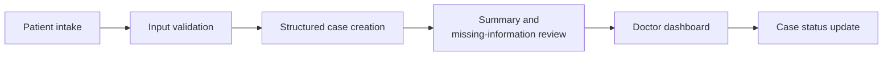
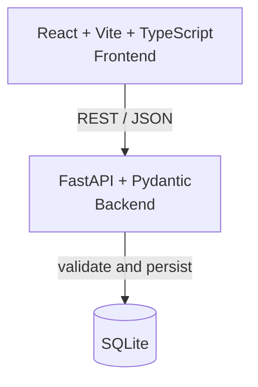

<div align="center">


<br/>

**A connected patient-intake and clinician-review workflow that turns patient-reported symptoms into structured, review-ready case summaries.**


[Overview](#overview) · [Problem](#the-problem) · [Workflow](#from-patient-narrative-to-review-ready-case) · [Demo](#see-clario-in-action) · [Architecture](#architecture) · [Features](#features-and-status) · [API](#api) · [Quickstart](#quickstart) · [Testing](#testing-and-verification) · [Safety](#safety-and-limitations) · [Roadmap](#roadmap)

</div>

> **Status note (remove once the source is pushed):** this README was written ahead of the code push. Feature statuses reflect the author's reported MVP scope. Folder names, commands, and endpoints below follow the intended design and should be re-checked against the repository after the push.

---

## Overview

**CLARIO** is a patient case-taking and clinical documentation prototype. A patient submits their story through an intake form; CLARIO validates it, stores it as a structured case, drafts a summary of what the patient reported, flags what is still missing, and presents it on a doctor dashboard where the case status can be updated.

### Project at a Glance

| | |
|---|---|
| **Category** | Healthcare workflow and documentation assistance (prototype) |
| **Intended users** | Patients (intake) and clinicians (review) |
| **Frontend** | React + Vite + TypeScript |
| **Backend** | FastAPI + Pydantic |
| **Storage** | SQLite (local file) |
| **Processing** | Rule-based, deterministic summary and missing-information logic. No LLM is required to run the core workflow. |
| **Status** | Working MVP, end-to-end local workflow |

---

## The Problem

Patient-reported information often arrives unstructured and incomplete: symptoms in free text, relevant history in a different field, key details absent altogether. At the workflow level, that means:

- Important context is scattered across fields and notes.
- Missing information surfaces late and requires follow-up.
- Clinicians have no consistent view of what the patient actually reported.
- Disconnected intake and review steps add avoidable friction.

CLARIO connects intake, structured summary, missing-information prompts, and clinician review into a single workflow. It does not diagnose, and it does not replace clinical judgment.

---

## From Patient Narrative to Review-Ready Case



What makes the workflow meaningful:

- **Connected, not isolated.** Patient intake and clinician review share one stored case, rather than being separate demo screens.
- **Structured storage.** Cases are validated and persisted in a database.
- **Transparent summaries.** The summary restates patient-reported facts instead of inferring conditions.
- **Explicit gaps.** Missing information is surfaced as prompts for follow-up.
- **Persistent status.** Case status changes are saved and survive a page refresh.
- **Clear boundaries.** Output is assistance for review, not a clinical decision.

---

## See CLARIO in Action

Screenshots will be captured from the running application using **synthetic data only**.

| Step | Screen | Asset |
|---|---|---|
| 1 | Patient intake form | `docs/assets/clario-patient-intake.png` *(to add)* |
| 2 | Submission and generated summary | `docs/assets/clario-case-summary.png` *(to add)* |
| 3 | Doctor dashboard and case queue | `docs/assets/clario-doctor-dashboard.png` *(to add)* |
| 4 | Case detail view | `docs/assets/clario-case-details.png` *(to add)* |
| 5 | Status update, persisted after refresh | `docs/assets/clario-status-update.png` *(to add)* |

---

## Architecture



- **Frontend:** intake form, doctor dashboard, case detail view, status controls.
- **Backend:** request validation, case creation, summary and missing-information generation, retrieval, status updates.
- **Database:** SQLite stores cases and their status locally.
- **Summaries:** generated by deterministic rules and templates, not by an LLM.

---

## Features and Status

| Feature | Status |
|---|---|
| Patient intake form | ✅ |
| Input validation | ✅ |
| Persistent case storage | ✅ |
| Structured patient-reported summary | ✅ |
| Missing-information prompts | ✅ |
| Conservative warning flags | ✅ |
| Doctor dashboard and case queue | ✅ |
| Case detail view | ✅ |
| Case status updates | ✅ |
| Optional LLM-generated summaries | 🗺️ Roadmap |
| Authentication and access control | 🗺️ Roadmap |
| Multilingual intake | 🗺️ Roadmap |
| Hosted deployment | 🗺️ Roadmap |

✅ = part of the working MVP. 🗺️ = planned, not yet built.

---

## Tech Stack

| Layer | Technology |
|---|---|
| Frontend | React, Vite, TypeScript |
| Backend | FastAPI, Pydantic |
| Database | SQLite |

---

## API

| Method | Endpoint | Purpose |
|---|---|---|
| `GET` | `/health` | Service health check |
| `POST` | `/api/cases` | Validate and create a case, returning the stored case with its summary |
| `GET` | `/api/cases` | List cases for the doctor dashboard |
| `GET` | `/api/cases/{id}` | Retrieve one case |
| `PATCH` | `/api/cases/{id}/status` | Update a case's status |

Invalid submissions are rejected with a validation error (HTTP 422). Interactive docs are available at `/docs` when the backend is running.

---

## Quickstart

**Prerequisites:** Python 3.10+, Node.js 18+, Git.

```bash
git clone https://github.com/Nishith45o7/CLARIO--health-intelligence-.git
cd CLARIO--health-intelligence-
```

**Backend** (terminal 1)

```bash
cd backend
python -m venv .venv
# macOS / Linux
source .venv/bin/activate
# Windows (PowerShell)
.venv\Scripts\Activate.ps1

pip install -r requirements.txt
uvicorn app.main:app --reload --port 8000
```

**Frontend** (terminal 2)

```bash
cd frontend
npm install
npm run dev
```

Open the frontend at `http://localhost:5173` and the API docs at `http://localhost:8000/docs`. No API keys are needed for the core workflow. The SQLite database file is created locally on first run.

**Troubleshooting**

- *`uvicorn` not found:* activate the virtual environment, then rerun `pip install -r requirements.txt`.
- *Port already in use:* change the port with `--port 8001` and update the frontend API URL.
- *PowerShell blocks activation:* run `Set-ExecutionPolicy -Scope Process RemoteSigned`.
- *Frontend cannot reach the API:* confirm the backend is running and CORS allows the frontend origin.

---

## Testing and Verification

Manual end-to-end check:

1. Open `/health` and confirm the service responds.
2. Submit a valid synthetic case and confirm a summary appears.
3. Submit with a required field empty and confirm validation rejects it.
4. Open the doctor dashboard and confirm the case is listed.
5. Open the case detail view, change the status, and refresh the page. The status should persist.
6. Restart the backend and confirm the case is still there.

Automated tests, if present, can be run with `pytest` in `backend/`. Results are intentionally not listed here until they have been run and recorded.

---

## Safety and Limitations

- CLARIO is a **workflow and documentation assistance prototype**.
- Summaries are **drafts for qualified clinician review**, not medical records or advice.
- Missing-information prompts are **not diagnoses**.
- Warning flags **do not replace clinical judgment**.
- The prototype is **not validated for clinical use**.
- Use **synthetic data only**. Do not enter real patient information.
- Production use would require privacy and security controls, authentication and access control, audit logging, and healthcare compliance review. None of these are currently implemented.

---

## Roadmap


- [ ] Multilingual intake
- [ ] Audit logging
- [ ] Hosted deployment
- [ ] Automated test suite and CI

---

## Repository Structure

```text
.
├── backend/          # FastAPI + Pydantic API, SQLite persistence
├── frontend/         # React + Vite + TypeScript app
├── docs/assets/      # README visuals
├── LICENSE
└── README.md
```

---

## Contributing

Issues and pull requests are welcome. Please use synthetic data in all examples, screenshots, and tests.

## License

Released under the [MIT License](LICENSE).

---

<div align="center">

**CLARIO helps clinicians start from clarity. Clinical decisions stay with clinicians.**

</div>
