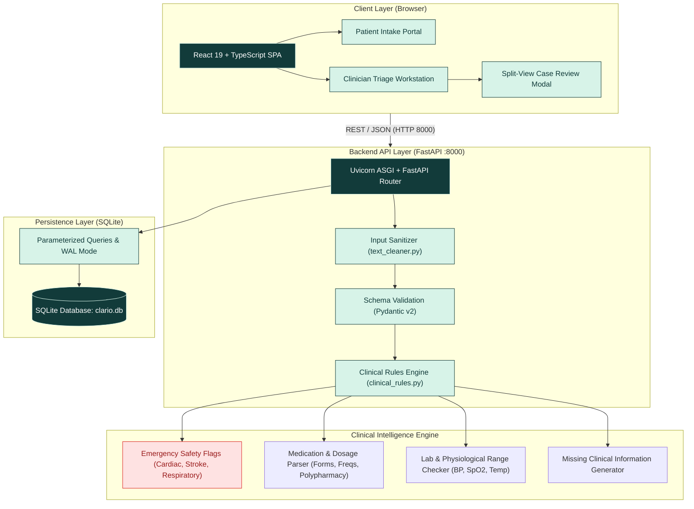
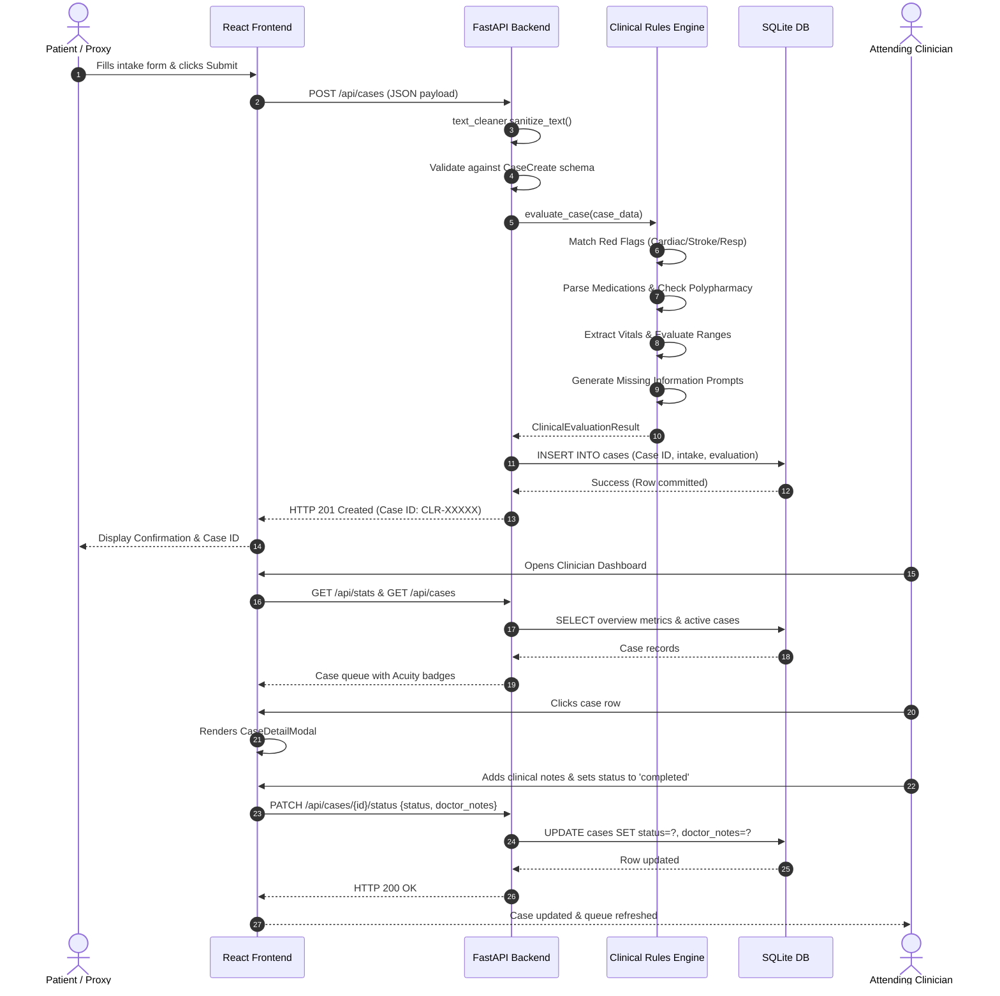

# CLARIO — System Architecture & Technical Design

**Document Version:** 1.0.0  
**Status:** Implemented & Verified  
**Date:** October 2026  
**System Name:** CLARIO — Health Intelligence  
**Repository:** [Nishith45o7/CLARIO--health-intelligence-](https://github.com/Nishith45o7/CLARIO--health-intelligence-)

---

## 1. Architectural Philosophy

CLARIO is engineered with three primary technical goals:
1. **Zero-Configuration Portability:** Runs immediately on any standard operating system (Windows, Linux, macOS) without requiring Docker, PostgreSQL setup, or third-party cloud accounts.
2. **Deterministic Predictability:** Clinical rule execution is deterministic, explainable, and instantaneous (< 10ms execution).
3. **Decoupled Modern Stack:** Clear separation between a high-performance Python FastAPI backend and a responsive React 19 + TypeScript frontend.

---

## 2. System Architecture Diagram



---

## 3. Component Breakdown

### 3.1 Frontend (`/frontend`)
- **Framework:** React 19 with TypeScript 5.8 and modern Vite 6 tooling.
- **Styling Architecture:** Vanilla CSS design tokens (`frontend/src/index.css`) utilizing HSL and hex variables (`#123B3A` Deep Teal, `#D7F3E8` Mint Accent, `#F7F9F7` Canvas). Zero heavy runtime CSS dependencies.
- **Icons:** `lucide-react` for clean, consistent healthcare iconography.
- **Components:**
  - `PatientIntakeForm.tsx`: Multi-section intake form with real-time field validation, quick-fill test presets, and immediate visual feedback.
  - `DoctorDashboard.tsx`: High-density clinical triage workstation featuring real-time overview metrics, instant multi-field search, status filtering, and acuity badges.
  - `CaseDetailModal.tsx`: Comprehensive split-view modal presenting patient-reported facts, automated clinical summary, safety red flag alerts, parsed medication tags, extracted vitals, and one-click status transitions.
  - `Header.tsx`: Unified header with route switching and live backend connectivity status.

### 3.2 Backend API (`/backend`)
- **Framework:** FastAPI with Uvicorn ASGI server.
- **Validation:** Pydantic v2 schemas (`backend/schemas.py`) ensuring strict data types, input sanitization, and schema enforcement.
- **Routing:**
  - `GET /health`: Health probe and database connectivity check.
  - `GET /api/stats`: Dynamic dashboard metrics (total, pending, in_review, completed, critical).
  - `GET /api/cases`: Filtered case list with search support.
  - `POST /api/cases`: New intake ingestion, clinical rule evaluation, and SQLite persistence.
  - `GET /api/cases/{case_id}`: Single case retrieval with full clinical payload.
  - `PATCH /api/cases/{case_id}/status`: Status lifecycle transition and notes persistence.

### 3.3 Clinical Rules Engine (`backend/clinical_rules.py`)
- **Text Cleaner (`backend/text_cleaner.py`):** Normalizes line endings, strips ASCII non-printables, and eliminates redundant spacing while preserving clinical negation terms.
- **Safety Red Flag Detector:** Deterministic regex pattern matching for high-acuity cardiovascular, cerebrovascular (FAST stroke criteria), and acute respiratory emergencies.
- **Medication & Dosage Parser:** Identifies pharmacological dosage units (`mg`, `mcg`, `ml`), delivery forms (`tab`, `cap`, `syp`, `inj`), and medical frequencies (`OD`, `BD`, `TDS`, `PRN`). Flags polypharmacy (≥ 5 drugs).
- **Vitals & Lab Checker:** Extracts quantitative physiological observations and assesses them against clinical danger thresholds (e.g., SpO2 < 92%, BP Systolic ≥ 180).
- **Missing Information Engine:** Scans clinical narratives to alert clinicians to omitted pain ratings, unconfirmed allergies, or ambiguous onset timelines.

### 3.4 Data Persistence (`backend/database.py`)
- **Database Engine:** SQLite 3.
- **Storage Location:** Persistent file at `backend/clario.db`.
- **Database Schema:**
```sql
CREATE TABLE IF NOT EXISTS cases (
    id TEXT PRIMARY KEY,
    created_at TIMESTAMP DEFAULT CURRENT_TIMESTAMP,
    updated_at TIMESTAMP DEFAULT CURRENT_TIMESTAMP,
    patient_name TEXT NOT NULL,
    age INTEGER NOT NULL,
    gender TEXT NOT NULL,
    chief_complaint TEXT NOT NULL,
    detailed_symptoms TEXT NOT NULL,
    duration TEXT,
    onset TEXT,
    medical_history TEXT,
    allergies TEXT,
    current_medications TEXT,
    additional_notes TEXT,
    status TEXT DEFAULT 'pending',
    has_emergency_flags BOOLEAN DEFAULT 0,
    emergency_flags TEXT,          -- JSON array of flag objects
    structured_summary TEXT,      -- Formatted clinical case summary
    missing_info_prompts TEXT,    -- JSON array of missing prompts
    parsed_medications TEXT,      -- JSON array of structured medication objects
    extracted_vitals TEXT,        -- JSON array of extracted vitals & lab alerts
    doctor_notes TEXT
);

CREATE INDEX IF NOT EXISTS idx_cases_status ON cases(status);
CREATE INDEX IF NOT EXISTS idx_cases_created_at ON cases(created_at);
```

---

## 4. Data Flow & Transaction Lifecycle



---

## 5. Security, Privacy & Reliability Guardrails

1. **SQL Injection Defense:** 100% of SQLite queries utilize parameterized statements (`?` parameters), preventing SQL injection vulnerabilities.
2. **CORS Hardening:** Configured with specific local origins and REST verbs.
3. **No External Network Dependencies:** Operates entirely within local subnets. No patient data ever leaves the local environment.
4. **Input Boundary Enforcement:** Strict Pydantic string length limits, regex sanitization, and type coercions prevent buffer overruns or malformed payload crashes.
