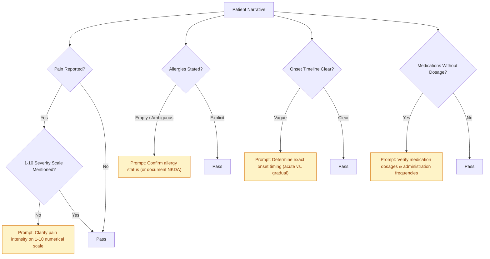

# CLARIO — Clinical Rules & Safety Engine Specification

**Document Version:** 1.0.0  
**Status:** Implemented & Verified  
**Date:** October 2026  
**Module:** `backend/clinical_rules.py` & `backend/text_cleaner.py`  
**Repository:** [Nishith45o7/CLARIO--health-intelligence-](https://github.com/Nishith45o7/CLARIO--health-intelligence-)

---

## 1. Safety Philosophy & Deterministic Core

In clinical software, **uncontrolled statistical inference (hallucination) poses an unacceptable safety risk**. CLARIO’s clinical rules engine enforces absolute determinism:
- Every flag is triggered by explicit, audited keyword combinations, verified clinical abbreviations, or numeric thresholds.
- Every rule provides **exact matched evidence** and **standardized emergency guidance**.
- Output is 100% reproducible: the same intake text always yields the identical clinical evaluation.

---

## 2. Emergency Red-Flag Trigger Categories

### 2.1 Acute Coronary Syndrome (ACS) & Cardiovascular Red Flags
- **Clinical Rationale:** Acute myocardial infarction requires emergency door-to-balloon intervention within minutes. Symptoms often present as pressure, radiation, or diaphoresis.
- **Pattern Matchers:**
  - Primary terms: `chest pain`, `chest pressure`, `crushing chest`, `tightness in chest`, `substernal pain`.
  - Radiation patterns: `radiating to arm`, `radiating to left arm`, `radiating to jaw`, `radiating to neck`, `radiating to back`.
  - Associated symptoms: `cold sweats`, `diaphoresis`, `sudden syncope`, `cardiac arrest`.
- **Severity Level:** `CRITICAL`
- **Clinical Action Guidance:** Immediate emergency evaluation (ED / 911 / EMS). STAT 12-lead ECG and continuous cardiac monitoring recommended.

### 2.2 Cerebrovascular & Stroke Warning (FAST Criteria)
- **Clinical Rationale:** Acute ischemic stroke outcomes depend strictly on thrombolytic or thrombectomy time windows ("Time is Brain").
- **Pattern Matchers:**
  - Facial Droop: `facial droop`, `face drooping`, `crooked smile`, `unequal face`.
  - Arm Weakness: `arm weakness`, `sudden weakness`, `hemiparesis`, `loss of motor control`, `cannot raise arm`.
  - Speech Difficulty: `slurred speech`, `aphasia`, `dysarthria`, `garbled words`, `cannot speak`.
  - Sudden Neurological Onset: `thunderclap headache`, `worst headache of life`, `sudden loss of vision`, `amaurosis fugax`.
- **Severity Level:** `CRITICAL`
- **Clinical Action Guidance:** Immediate emergency stroke pathway activation. Non-contrast head CT and last-known-well timeline determination required.

### 2.3 Severe Respiratory Distress & Airway Compromise
- **Clinical Rationale:** Hypoxemia and respiratory exhaustion can lead to rapid respiratory failure.
- **Pattern Matchers:**
  - Work of Breathing: `severe shortness of breath`, `cannot catch breath`, `gasping for air`, `accessory muscle use`.
  - Airway & Sound: `stridor`, `audible wheezing`, `choking`, `airway obstruction`.
  - Visual Indicators: `cyanosis`, `blue lips`, `blue fingertips`, `asphyxia`.
- **Severity Level:** `CRITICAL`
- **Clinical Action Guidance:** Immediate airway, breathing, and circulation (ABC) evaluation. Supplemental high-flow oxygen and SpO2 monitoring.

### 2.4 Severe Hemorrhage & Shock
- **Clinical Rationale:** Uncontrolled bleeding or vascular rupture causes hypovolemic shock.
- **Pattern Matchers:**
  - `massive bleeding`, `uncontrolled hemorrhage`, `vomiting blood`, `hematemesis`, `coughing up blood`, `hemoptysis`, `black tarry stools`, `melena`.
- **Severity Level:** `CRITICAL`
- **Clinical Action Guidance:** Immediate vascular access, volume resuscitation, and surgical/interventional consultation.

---

## 3. Vulnerable Population & Age Advisories

| Population | Condition | Advisory Message | Severity |
|---|---|---|---|
| **Pediatric** | Age < 2 years | "Infant / young pediatric presentation requires specialized clinical evaluation and close fever/dehydration monitoring." | `WARNING` |
| **Geriatric** | Age ≥ 75 years | "Geriatric presentation: evaluate for atypical disease presentation, cognitive baseline changes, fall risk, and medication interactions." | `WARNING` |

---

## 4. Medication & Polypharmacy Parser

The parser extracts pharmacological details from free-text patient entries:

### 4.1 Extracted Entities
- **Form:** `tablet` (tab), `capsule` (cap), `syrup` (syp), `injection` (inj), `inhaler`, `drops`, `ointment`, `patch`.
- **Dosage:** Numeric value accompanied by medical units (`mg`, `mcg`, `ml`, `IU`, `g`, `units`).
- **Frequency:** Standard medical abbreviations and frequencies:
  - `OD` (once daily)
  - `BD` / `BID` (twice daily)
  - `TDS` / `TID` (three times daily)
  - `QID` (four times daily)
  - `PRN` (as needed)
  - `daily`, `weekly`, `at bedtime` (HS)

### 4.2 Polypharmacy Detection
- **Trigger Rule:** If unique identified medications ≥ 5.
- **Severity:** `ADVISORY`
- **Clinical Guidance:** Alert clinician to conduct medication reconciliation, evaluate drug-drug interactions, and review renal clearance requirements.

---

## 5. Physiological Lab & Vitals Range Checker

The engine scans patient narratives and clinical notes for mentioned vital signs and lab values:

| Physiological Metric | Normal Reference Range | Alert Trigger Thresholds | Generated Clinical Alert |
|---|---|---|---|
| **Oxygen Saturation (SpO2)** | 95% – 100% | `< 92%` (Critical: `< 88%`) | ⚠️ Hypoxemia Warning: SpO2 critically low |
| **Blood Pressure (Systolic)** | 90 – 120 mmHg | `≥ 180 mmHg` (or `< 90 mmHg`) | ⚠️ Hypertensive Crisis / Hypotension Warning |
| **Blood Pressure (Diastolic)**| 60 – 80 mmHg | `≥ 120 mmHg` (or `< 60 mmHg`) | ⚠️ Severe Diastolic Anomaly |
| **Heart Rate / Pulse** | 60 – 100 bpm | `> 110 bpm` or `< 50 bpm` | ⚠️ Tachycardia / Bradycardia Alert |
| **Body Temperature** | 97.0°F – 99.5°F | `> 102.5°F` (39.2°C) | ⚠️ High Fever Alert |
| **Blood Glucose** | 70 – 140 mg/dL | `> 250 mg/dL` or `< 60 mg/dL`| ⚠️ Severe Hyperglycemia / Hypoglycemia Alert |
| **Hemoglobin (Hb)** | 12.0 – 17.5 g/dL | `< 8.0 g/dL` | ⚠️ Severe Anemia Alert |

---

## 6. Missing-Information Prompt Engine

When patients omit vital diagnostic parameters, CLARIO alerts the clinician prior to consultation:

### Prompt Rationale Table
1. **Pain Severity Scale (1-10):** Prevents ambiguity; ensures standard visual analog scale or numerical rating scale documentation.
2. **Allergy Confirmation:** Eliminates dangerous assumptions of "No Known Drug Allergies (NKDA)" when the field was simply skipped.
3. **Onset Trajectory:** Differentiates hyperacute onset (e.g., vascular catastrophe) from subacute or chronic progression.
4. **Medication Reconciliation:** Prevents under-dosing or toxic over-dosing when patients write only drug names (e.g., "Metformin") without milligram strength.
