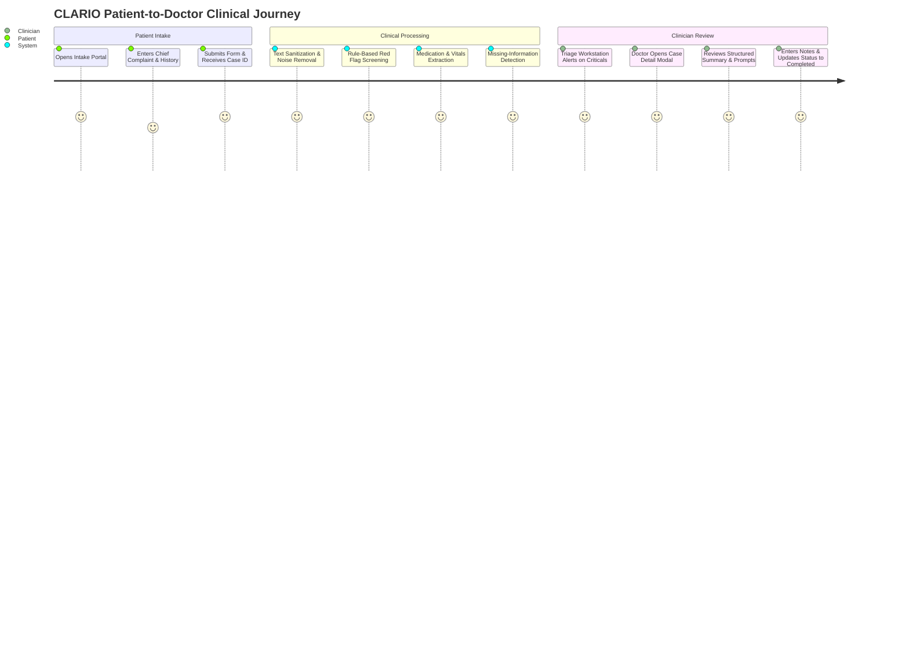

# CLARIO — Product Requirements Document (PRD)

**Document Version:** 1.0.0  
**Product Status:** Production-Ready Prototype  
**Date:** October 2026  
**Product Title:** CLARIO — Health Intelligence  
**Repository:** [Nishith45o7/CLARIO--health-intelligence-](https://github.com/Nishith45o7/CLARIO--health-intelligence-)

---

## 1. Executive Summary & Vision

### 1.1 The Vision
**CLARIO** bridges the gap between chaotic patient stories and structured clinical clarity. In fast-paced healthcare environments—emergency departments, walk-in clinics, and outpatient triage—intake information is frequently fragmented, disorganized, and missing crucial clinical qualifiers. 

CLARIO transforms patient-reported symptoms into standardized, structured clinical summaries, proactively highlights missing facts before the consultation, screens for critical safety flags, and presents everything to clinicians in an intuitive, real-time triage workstation.

### 1.2 Core Philosophy: Determinism Over Hallucination
Unlike generic generative AI tools that risk fabricating medical symptoms or hallucinating drug interactions, CLARIO is built on a **deterministic, rule-based clinical engine**. Every alert, medication extraction, and missing-information prompt is 100% transparent, explainable, and reproducible, with zero cloud dependency and zero latency unpredictability.

---

## 2. Problem Statement & User Pain Points

### 2.1 The Clinical Problem
1. **Unstructured Narrative Scatter:** Patients explain symptoms in lengthy, emotional stories where critical diagnostic facts (e.g., onset timing, radiation of pain, associated dizziness) are buried.
2. **Missing Clinical Facts:** Basic details required for clinical risk stratification (e.g., pain score on 1-10 scale, allergy status confirmation, medication frequency) are omitted during intake, requiring clinicians to conduct repetitive fact-finding.
3. **Delayed Triage of High-Acuity Presentations:** Subtly described emergencies (e.g., "tightness in chest spreading to jaw" or "sudden arm heaviness") can get lost in generic waiting queues.
4. **Physician Burnout & Charting Burden:** Doctors spend up to 2 hours documenting for every 1 hour of direct patient care.

### 2.2 User Personas

| Persona | Role | Primary Goals | Key Pain Points |
|---|---|---|---|
| **Dr. Sarah Miller** | Emergency / Triage Physician | Fast case review, zero hallucinated facts, immediate red flag visibility. | Wasting 5–10 minutes extracting basic facts from unformatted patient text. |
| **Nurse Michael Chen** | Intake & Triage Coordinator | Rapid patient registration, queue prioritization, identifying urgent patients. | Managing crowded waiting rooms without real-time risk indicators. |
| **Elena Rostova** | Patient (Walk-in Clinic) | Clear, easy intake interface, assurance that medical details reach the doctor. | Anxious, overwhelmed by complex medical forms, forgets key history. |

---

## 3. Product Scope & Workflow

### 3.1 End-to-End User Journey

### 3.2 Product Modules
1. **Patient Intake Module (`/`):**
   - Clean, accessible multi-card intake interface.
   - Real-time client-side field validation.
   - Quick-Fill demo presets for rapid demonstration.
   - Persistent submission with distinct Case ID (`CLR-XXXXX`).

2. **Clinical Rules & Triage Engine (Backend):**
   - High-performance text cleaner (`text_cleaner.py`).
   - Cardiovascular, stroke, respiratory, and hemorrhagic safety flags.
   - Pediatric & geriatric risk advisories.
   - Medication parsing (forms, dosages, frequencies) and polypharmacy detection.
   - Physiological range checking (BP, SpO2, HR, Temp, Glucose, Hb).
   - Missing information prompts generator.

3. **Clinician Triage Workstation (`/dashboard`):**
   - Live metrics bar (Total, Pending, In Review, Completed, Critical).
   - Instant search and multi-status tabbed filter.
   - Case row highlighting for high-acuity/emergency cases.
   - Split-view review modal with editable assessment notes.
   - Persistent SQLite status tracking.

---

## 4. Feature Prioritization (MoSCoW Matrix)

| Category | Features |
|---|---|
| **Must Have (P0 - Implemented)** | • Structured patient intake form with client validation. • Deterministic red-flag detection (cardiac, stroke, respiratory). • Missing-information prompt engine. • Persistent SQLite case storage with unique case IDs. • Clinician triage workstation with live stats, search, and filter tabs. • Split-view case review modal with status updates. • Automated integration test suite with 100% pass rate. |
| **Should Have (P1 - Implemented)** | • Advanced clinical text cleaner (stripping whitespace, control chars, noise). • Structured medication & dosage extraction (forms, dosages, frequencies). • Polypharmacy risk detection (≥ 5 medications). • Quantitative vitals & lab range anomaly checking (SpO2, BP, Temp). • Quick-fill demo presets for instant testing. |
| **Could Have (P2 - Roadmap)** | • Export case summary to standardized clinical PDF / HL7 FHIR format. • Speech-to-text intake for hands-free patient reporting. • Multi-language localized intake screens. |
| **Won't Have (Out of Scope)** | • Autonomous diagnosis or clinical treatment prescription (safety guardrail). • Unchecked cloud LLM generation in the core critical path. |

---

## 5. Clinical Safety & Non-Diagnostic Guardrails

CLARIO is strictly designed as a **clinical documentation and triage assistant**, not a medical device or diagnostic substitute:
1. **Clear Disclaimers:** Prominently displayed across the intake portal and physician workstation.
2. **Deterministic Rules:** No statistical hallucinations; warnings trigger exclusively on verified keywords and physiological metrics.
3. **Physician Ownership:** Summaries and prompts are provided as editable drafts; final clinical judgment remains with the attending physician.
4. **Synthetic Data Integrity:** All pre-packaged test cases use synthetic patient fixtures.

---

## 6. Success Metrics & Key Performance Indicators (KPIs)

| Metric | Target | Measurement Method |
|---|---|---|
| **Time-to-Review** | < 45 seconds per case | Measured from modal open to status completion. |
| **Critical Red Flag Detection** | 100% recall on acute cardiac, stroke, and respiratory triggers | Verified via automated integration tests (`test_api.py`). |
| **Missing Info Identification** | > 95% detection rate for omitted pain scores and allergy details | Verified on synthetic patient intake batches. |
| **System Latency** | < 100ms API response time | Measured across all endpoint transactions. |
| **Zero-Failure Reliability** | 100% availability offline | No external network dependencies or token limits. |
