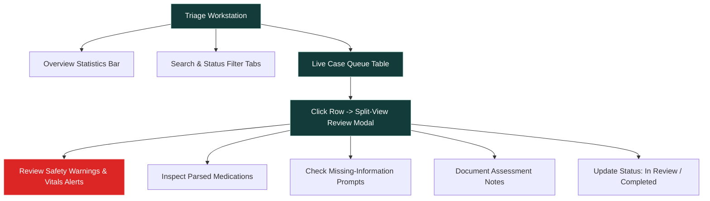

# CLARIO — User Guide & Operational Manual

**Document Version:** 1.0.0  
**Status:** Implemented & Verified  
**Date:** October 2026  
**System Name:** CLARIO — Health Intelligence  
**Repository:** [Nishith45o7/CLARIO--health-intelligence-](https://github.com/Nishith45o7/CLARIO--health-intelligence-)

---

## 1. Introduction

CLARIO is designed with two distinct digital interfaces:
1. **Patient Intake Portal:** A clean, accessible interface where patients or their care partners submit symptom narratives, current medications, and past medical history.
2. **Clinician Triage Workstation:** A real-time workstation where triage nurses and physicians monitor incoming cases, identify critical red flags, review structured case drafts, and manage review statuses.

---

## 2. Patient Intake Portal (`http://localhost:3000`)

### 2.1 Entering a Patient Case
1. **Demographics:**
   - Enter Patient Full Name (e.g., `Eleanor Vance`).
   - Enter Age (e.g., `68`).
   - Select Biological Sex (`Female`, `Male`, or `Other`).
2. **Chief Complaint:**
   - Provide a concise statement of the primary reason for visit (e.g., `Crushing chest pressure with left arm radiation`).
3. **Detailed Symptoms:**
   - Describe onset, location, severity, and associated symptoms (e.g., `Started 30 minutes ago while resting. Rated 8/10 on pain scale. Associated with cold clammy sweats. SpO2 91% on pulse oximeter`).
4. **History & Medications:**
   - Enter known medical conditions (e.g., `Type 2 Diabetes, Hypertension`).
   - List known allergies (e.g., `Penicillin (severe hives)` or `None`).
   - Enter current medications with form and frequency (e.g., `Metformin 500mg tab BD, Lisinopril 10mg tab OD`).
5. **Submission:**
   - Click **Submit Case**.
   - The system immediately processes the intake, evaluates safety rules, generates a persistent Case ID (e.g., `CLR-91596`), and displays a success confirmation.
   - Click **Open in Doctor Dashboard** to navigate directly to the clinician view for that case.

### 2.2 Using Quick-Fill Demo Presets
For testing or hackathon demonstrations, use the quick-fill buttons located at the top of the intake form:
- **Preset 1: Chest Pressure (Red Flag Demo):** Simulates an acute cardiovascular emergency with chest pain radiating to the left arm and abnormal SpO2.
- **Preset 2: Cough & Fever (Moderate Demo):** Simulates an infectious respiratory presentation (flu/bronchitis) with temperature and medication history.
- **Preset 3: Infant High Fever (Pediatric Advisory Demo):** Demonstrates age-based vulnerability flags for a 9-month-old infant with high fever.

---

## 3. Clinician Triage Workstation (`http://localhost:3000/dashboard`)

### 3.1 Overview Statistics Bar
Located at the top of the dashboard, tracking key workflow metrics:
- **Total Cases:** Total patient intake records stored in SQLite.
- **Pending Review:** Cases awaiting initial clinician attention.
- **In Review:** Cases currently being examined by a clinician.
- **Completed:** Finalized cases with saved clinician notes.
- **Critical Flags:** Cases triggering emergency safety rules (cardiac, stroke, respiratory distress).

### 3.2 Filtering & Searching
- **Status Filter Tabs:** Switch between `All Cases`, `Pending`, `In Review`, `Completed`, and `Critical Flags`.
- **Search Bar:** Type any part of a patient name, case ID, or chief complaint to filter instantly in real time.

### 3.3 Case Review Modal (Split-View)
Clicking any case row opens the comprehensive review modal:
- **Left Column — Patient-Reported Information:**
  - Raw patient narrative exactly as submitted.
  - Demographics, duration, onset, past history, and allergies.
- **Right Column — Clinical Intelligence & Case Draft:**
  - **Emergency Red Flag Banners:** Highlighted in high-visibility red with exact matched terms and immediate recommended clinical actions.
  - **Extracted Vitals & Range Alerts:** Badges displaying extracted blood pressure, oxygen saturation, and body temperature with clinical anomaly warnings.
  - **Parsed Medications:** Structured medication pills displaying drug name, form (`tab`, `cap`), strength (`500mg`), and frequency (`BD`, `OD`).
  - **Missing Information Prompts:** Amber warning tags alerting the physician to unspecified pain scores (1-10) or unconfirmed allergies.
  - **Structured Clinical Summary:** An organized, objective clinical draft ready for copying into the EHR/EMR.
  - **Clinician Assessment Notes:** Scratchpad to record physician impressions, diagnostic plan, or bedside findings.
- **Status Action Buttons:**
  - Click **Mark In Review** when starting examination.
  - Click **Mark Completed** to finalize and archive.
  - Changes are saved immediately to the SQLite database and persist across page refreshes.
